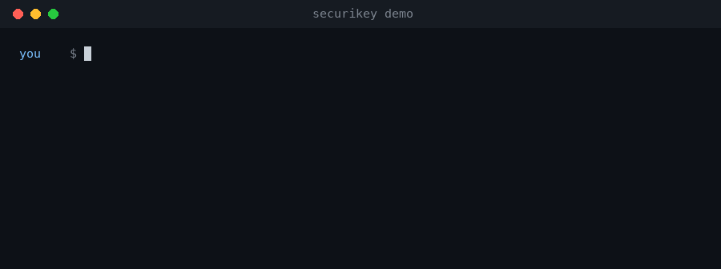

<h1 align="center"></h1>

[](https://github.com/CodeAndCanvas728/securikey/actions/workflows/ci.yml)
[](LICENSE)


**Keeps API keys and tokens out of Claude's context.** Secrets live in the OS keychain, and the agent only ever works with their **names**. A prompt or tool call that contains a secret is blocked, and tool output is redacted before the model sees it, whenever the call succeeds or the command was started with `skey run`.

One gap, stated up front: if a command that did **not** get its secret through `skey run` fails (non-zero exit), Claude Code skips the redaction hook and the model sees what it printed. [Details and what covers it](#known-gap-a-failing-command).



*Animated from a real capture: a throwaway keychain entry and a demo value, with the commands typed out and the output exactly as printed. The green line is an annotation, not output.* The same idea in text, with a real API call added:

```text
you    $ skey add github                                  # hidden prompt, stored in the OS keychain
agent  $ skey run --env GH_TOKEN=github -- gh api user    # only the child process gets the value
agent  $ skey run --env GH_TOKEN=github -- sh -c 'echo "token: $GH_TOKEN"; exit 1'
       token: [securikey:github]                          # redacted, and the exit status is still 1
```

## Quickstart

```bash
claude plugin marketplace add CodeAndCanvas728/securikey
claude plugin install securikey@codeandcanvas
skey add github        # in your own terminal; link it first (see Install)
```

Needs [`uv`](https://docs.astral.sh/uv/) and Claude Code 2.1.295 or later. macOS and Linux.

## What it guarantees

| Path a secret could take | What happens |
|---|---|
| You paste a token into a prompt | `UserPromptSubmit` blocks it before it is sent; nothing reaches the API |
| The agent puts a secret in a tool call (command, file edit, MCP call) | `PreToolUse` denies the call and names the secret, never its value |
| A tool call that **succeeds** prints a secret | `PostToolUse` replaces the output with a redacted copy before the model sees it |
| A command started with `skey run` prints a secret, **even if it fails** (when its output is piped, as an agent's is; at a terminal it is not filtered) | `skey run` redacts its child's stdout and stderr itself and keeps the exit status |
| The agent tries to read a dotenv file | Blocked; `skey import` moves the values into the keychain and leaves `securikey:<name>` references |
| A command needs the secret | `skey run` injects it into that one child process's environment |

Detection is exact for stored secrets (including their base64 and URL-encoded forms, so no false positives) and pattern-based for common provider formats you haven't stored yet (GitHub, Anthropic, OpenAI, AWS, Slack, Stripe, Google, JWT, private keys: `skey patterns`).

### Known gap: a failing command

Claude Code runs the redaction hook only when a tool call succeeds. A command that exits non-zero hands its output to the model unredacted, and no hook can change that (checked on Claude Code 2.1.316). SecuriKey detects a secret in a failed call and warns you, and `skey run` covers the commands it starts. A failing command that read a secret some other way is not covered: rotate a secret that was printed. See [docs/limits.md](docs/limits.md#a-failed-call-is-not-redacted-unless-skey-run-started-it).

## Limits at a glance

Full list, with the reasons: [docs/limits.md](docs/limits.md).

- It can't un-run a command: a script that sends a secret over the network still sends it. Redaction controls what the **model** sees.
- Claude Code's local transcript records tool output before a hook rewrites it. The guarantee is about the model and the API, not your disk.
- A command can transform a secret before printing it (reversed, hex, split), and that text is not redacted. [`tests/test_known_bypasses.py`](tests/test_known_bypasses.py) pins this.
- A secret in an unknown format that you never stored can't be recognised; store it and it is covered exactly. Values under 8 characters are never redacted.
- If the keychain is locked, the hooks fall back to pattern matching and tell you.
- The hooks are Claude Code only; the `skey` CLI works from any shell.

## Install

From a session:

```text
/plugin marketplace add CodeAndCanvas728/securikey
/plugin install securikey@codeandcanvas
```

Or from the shell:

```bash
claude plugin marketplace add CodeAndCanvas728/securikey
claude plugin install securikey@codeandcanvas
```

To try a checkout instead of installing it: `claude --plugin-dir /path/to/securikey/plugin`.

`bin/` is on Claude Code's `PATH` while the plugin is enabled, so the agent runs `skey` directly. For your own terminal, link it: `ln -s /path/to/securikey/plugin/bin/skey ~/.local/bin/skey`. All three hooks set `onFailure: "block"`, so an input or prompt hook that cannot start stops the call instead of letting it through. That means a missing `uv` stops every tool call: run `skey doctor` after installing, and disable the plugin with `claude plugin disable securikey` if you need to get unstuck.

On macOS the first keychain access asks to allow `python`; choose **Always Allow**. On Linux the keychain needs a Secret Service provider (GNOME Keyring or KWallet). claude.ai and Cowork do not install a plugin with a top-level `bin/` directory, so this plugin is for the Claude Code CLI and the desktop app.

Coming from token-vault? See [docs/migrating.md](docs/migrating.md).

## Use

```bash
skey add github                                  # hidden prompt; never pass a value as an argument
skey list
skey add --config local_api                     # configuration, not a secret (a local server address): not redacted or blocked
skey run --env GH_TOKEN=github -- gh api user
skey import .env --dry-run && skey import .env     # the secrets it recognised become names
skey run --dotenv .env -- npm run dev
skey rm github
```

### How the references work

`skey import` moves a value into the keychain and leaves the **name** behind:

```bash
# .env                          # after skey import .env
API_KEY=sk-ant-api03-...        API_KEY=securikey:api_key
```

`securikey:<name>` is a marker, not a value. Nothing expands it on its own, so the file is safe to commit. To hand the value to a command, start the command through `skey run`:

```bash
skey run --dotenv .env -- npm run dev           # the child gets API_KEY=<the real value>
skey run --env API_KEY=api_key -- npm run dev   # or name the secret directly
```

`skey run` resolves the references into the child's environment. At a terminal it then replaces itself with the command. When its stdout is piped (the way an agent runs it) it runs the command, passes the exit status through and redacts stdout and stderr itself; `SECURIKEY_RUN_FILTER=0` turns that off. An application that reads the dotenv file itself, without `skey run`, sees the literal `securikey:api_key`.

`skey run --dotenv <file>` is only allowed when **every** value in the file is already a name: a file that still holds a plaintext value would put it into the child's environment, so the hook blocks it and asks for `skey import` first. `skey import` moves the values it recognises and tells you which ones it left behind, because those are still in the file in plaintext. It treats `KEY`, `TOKEN`, `SECRET`, `PASSWORD`, `PASS`, `PRIVATE`, `CREDENTIAL`, `AUTH` and `DSN` keys, and any provider-shaped token, as secrets; `skey import --all` moves everything.

`scan_all_git_repos.sh --dir ~/Documents [--apply]` does the same across many repositories (dry run by default, backs each file up until the import succeeds). It is a maintenance script and is not shipped with the plugin.

## Unattended agents

Running under Paperclip or another host that injects secrets into the environment: [docs/paperclip.md](docs/paperclip.md) covers `SECURIKEY_WATCH_ENV`, per-org keychain services, headless mode, seeding and rotating secrets, the audit log and `skey doctor --headless`.

## Design choices

- **The OS keychain does the cryptography.** Secrets are one keychain item (a JSON map); there is no vault file and no custom crypto to get wrong.
- **No MCP server.** Any tool that returns a secret puts it into the model's context, which is the thing this plugin exists to prevent.
- **Fail closed where it matters.** All three hooks set `onFailure: block`, so a broken install stops tool calls and prompts instead of silently waving them through, and any other failure inside a hook denies, blocks or replaces the output rather than passing it unjudged.
- **The limits are tested, not just written down.** Known bypasses are pinned as tests, and hook behaviour is checked against a real Claude Code session, not only unit tests: that is how the failing-command gap was found.
- **Small:** about 2,600 lines of stdlib Python plus `keyring`, with hermetic tests.

## Develop

```bash
PYTHONPATH=plugin uv run --python 3.12 python -m unittest discover -s tests -t .
claude plugin validate plugin --profile directory
claude plugin validate .
```

```text
plugin/          what an install ships: .claude-plugin/, bin/skey, hooks/, skills/, securikey/ (the code)
tests/           hermetic unit tests, including manifest checks
docs/            limits, Paperclip, migration
bench/           hook latency measurement (not shipped)
```

The plugin lives in `plugin/` on purpose: a marketplace entry's `source` is a directory and everything under it is installed, so the tests, docs and scripts stay out of what users get. CI runs the tests, `claude plugin validate` (pinned Claude Code) and a check that no secret pattern is committed, on Ubuntu and macOS.

MIT licensed. Changes: [CHANGELOG.md](CHANGELOG.md).
